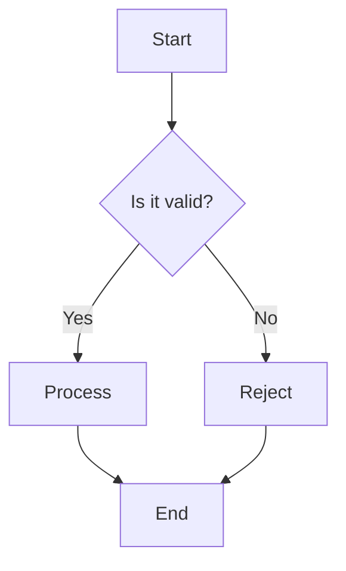

# Beautiful Markdown Writing

## Core Philosophy

- **Readable source**: The raw Markdown should look good, not just the rendered output
- **Cross-platform**: Works in GitHub, Obsidian, OpenCode, Codex, standard parsers, and any renderer
- **Semantic structure**: Use headings for outline, not for font size
- **Visual hierarchy**: Whitespace, alignment, and grouping guide the eye
- **Deliverable-first**: Put the result/output before the explanation when writing docs for agents/LLMs

---

## File Header Template

### GitHub README.md

```markdown
# Project Name

> One-line description of what this does.

[]()
[]()
[]()

Brief paragraph explaining purpose and value proposition.

- [Features](#features)
- [Installation](#installation)
- [Usage](#usage)
- [API](#api)
- [Contributing](#contributing)
- [License](#license)
```

### Obsidian Note

```markdown
---
title: Note Title
date: 2026-05-12
tags: [topic, subtopic]
aliases: ["Alternative Name"]
cssclass: clean-embeds
---

# Note Title

> Context or definition block

Summary paragraph.
```

### OpenCode Documentation / AGENTS.md

```markdown
---
description: What this directory does and conventions to follow
glob: "**/*.{ts,tsx,js,jsx}"
alwaysApply: true
---

# Directory Name

> Conventions and rules for code in this directory.

## File Structure
- `src/` — Source code
- `tests/` — Test files
- `docs/` — Documentation

## Coding Rules
1. Use TypeScript strict mode
2. No `any` types
3. All exports must be named

## Commands
```bash
npm run build   # Build the project
npm run test    # Run tests
npm run lint    # Lint code
```
```

### Codex Agent Doc / .codex.md

```markdown
---
description: Agent configuration and conventions for this project
model: gpt-5.2-codex
tools: terminal, file, web
---

# Project Name — Agent Doc

> How the Codex agent should operate in this codebase.

## Environment
- Python 3.12, virtualenv in `.venv/`
- PostgreSQL 16, connection string in `.env`
- Redis for caching on `localhost:6379`

## Conventions
- Tests in `tests/` mirroring `src/` structure
- Use `pytest -xvs` for debugging, `pytest -n auto` for CI
- Never commit `.env` or `__pycache__/`

## Common Pitfalls
- Database migrations need `FLASK_APP=app.py` set
- Redis must be running before `pytest` integration tests
```

---

## Typography Rules

| Element | Rule | Example |
|---------|------|---------|
| Headings | Sentence case, no period | `## Installation` |
| Lists | Parallel grammar, consistent punctuation | All items start with verb |
| Code | Backticks for inline, fences for blocks | `` `function()` `` |
| Emphasis | `**bold**` for UI/keys, `*italic*` for emphasis | Press **Enter** |
| Links | Descriptive text, no "click here" | [Read the docs](./docs) |
| Images | Alt text always, caption below if needed | `` |
| Keyboard | `<kbd>` tags for key combinations | `<kbd>Ctrl</kbd>+<kbd>C</kbd>` |

**Spacing:**
- Blank line before and after headings
- Blank line before and after code fences
- Blank line between list items if they contain multiple lines
- No blank line between short related list items

---

## Emoji & Icon Style Guide

Use emojis sparingly as visual anchors in headings and callouts. Consistent mapping:

| Section / Context | Emoji | Usage |
|:------------------|:-----:|:------|
| Warning / Danger | ⚠️ | `> **⚠️ Warning:** ...` |
| Important / Key | 🔑 | `> **🔑 Key Point:** ...` |
| Note / Info | ℹ️ | `> **ℹ️ Note:** ...` |
| Tip / Advice | 💡 | `> **💡 Tip:** ...` |
| Success / Done | ✅ | `- ✅ Feature complete` |
| In Progress | 🚧 | `- 🚧 Work in progress` |
| Blocked / No | ❌ | `- ❌ Deprecated` |
| Bug / Fix | 🐛 | `- 🐛 Known issue` |
| Performance | ⚡ | `- ⚡ Optimized path` |
| Security | 🔒 | `- 🔒 Auth required` |
| Config / Settings | ⚙️ | `## ⚙️ Configuration` |
| Metrics / Stats | 📊 | `## 📊 Benchmarks` |

---

## Tables

Align columns for readability. Use pipes at start and end.

```markdown
| Feature | Status | Notes |
|:--------|:------:|:------|
| Auth    |   ✅   | JWT + refresh tokens |
| Billing |   🚧   | Stripe integration pending |
| Export  |   ❌   | Planned for Q3 |
```

Tips:
- Left-align text, center-align status/icons, right-align numbers
- Keep tables under 120 chars wide
- Use `<br>` for multi-line cell content if needed
- Use `<kbd>` for keyboard shortcuts in tables

---

## Code Blocks

### Always Specify Language

````markdown
```python
def hello(name: str) -> str:
    return f"Hello, {name}!"
```
````

### Syntax Highlighting Language Reference

| Language ID | File/Output Type |
|:------------|:-----------------|
| `python` | Python (`.py`) |
| `javascript`, `js` | JavaScript |
| `typescript`, `ts` | TypeScript |
| `bash`, `sh`, `shell` | Shell scripts |
| `zsh` | Zsh scripts |
| `json` | JSON data |
| `jsonc` | JSON with comments (VS Code configs) |
| `yaml`, `yml` | YAML config |
| `toml` | TOML config |
| `ini`, `env` | INI / dotenv files |
| `markdown`, `md` | Markdown source |
| `html` | HTML |
| `css` | CSS |
| `scss`, `sass` | SCSS / Sass |
| `sql` | SQL queries |
| `graphql` | GraphQL queries |
| `diff` | Unified diffs |
| `ansi` | Terminal colored output |
| `console`, `txt`, `text` | Plain terminal output (no highlighting) |
| `mermaid` | Mermaid diagrams |
| `rust`, `go`, `java`, `kotlin`, `swift`, `c`, `cpp` | Systems languages |

### Code Block Metadata

Add `title` or `filename` for context (works in many renderers):

````markdown
```python title="src/main.py"
def main():
    ...
```
````

Alternative format for GitHub / VitePress:

````markdown
```python [src/main.py]
def main():
    ...
```
````

### Diff Blocks

````markdown
```diff
- old_line()
+ new_line()
```
````

---

## GitHub-Specific Features

### Collapsible Sections

```markdown
<details>
<summary>Click to expand error log</summary>

```
Error: Connection refused at 0.0.0.0:8080
```

</details>
```

### Task Lists

```markdown
- [x] Phase 1: Core API
- [ ] Phase 2: WebSocket support
- [ ] Phase 3: Admin dashboard
```

### GFM Alerts

```markdown
> [!NOTE]
> Useful information that users should know.

> [!TIP]
> Helpful advice for doing things better.

> [!IMPORTANT]
> Key information users need to know.

> [!WARNING]
> Urgent info that needs immediate attention.

> [!CAUTION]
> Advises about risks or negative outcomes.
```

### Mermaid Diagrams

````markdown

````

Common Mermaid types: `flowchart`, `sequenceDiagram`, `classDiagram`, `stateDiagram`, `gantt`, `pie`, `erDiagram`, `journey`, `gitGraph`, `mindmap`, `timeline`

### Image Sizing (HTML fallback)

```markdown


<!-- Or with Markdown for alt, HTML for size -->
{width=600}
```

> The `{width=N}` syntax works in many renderers. For maximum compatibility, use ``.

### Anchor Generation Rules

GitHub auto-generates heading anchors:
- Lowercased, spaces → hyphens, punctuation removed
- `## API Reference` → `#api-reference`
- `## C++ Support` → `#c-support`
- Duplicates get `-1`, `-2` suffixes

Custom anchors (works in GitHub + most parsers):

```markdown
## <a id="custom-anchor"></a> My Heading
```

---

## Obsidian-Specific Features

### Callouts

```markdown
> [!info] Title
> Content here

> [!warning]
> Content without custom title

> [!tip|right] Floating tip
> Content
```

Available types: `note`, `abstract`, `info`, `todo`, `tip`, `success`, `question`, `warning`, `failure`, `danger`, `bug`, `example`, `quote`

Modifiers: `|left`, `|right`, `|center`, `|fold` (collapsed by default)

### Wikilinks

```markdown
[[Another Note]]
[[Another Note|Display Text]]
[[Another Note#Heading]]
[[Another Note#Heading|Display]]
```

Use standard Markdown links `[]()` for GitHub/OpenCode/Codex compatibility when needed.

### Embeds

```markdown
![[Another Note]]
![[image.png]]
![[Document.pdf]]
```

### Math (LaTeX)

```markdown
Inline: $E = mc^2$

Block:
$$
\int_{a}^{b} f(x) \, dx = F(b) - F(a)
$$
```

### Dataview Queries

```markdown
```dataview
TABLE file.mtime AS Modified, tags
FROM #project/active
SORT file.mtime DESC
LIMIT 10
```
```

---

## OpenCode-Specific Features

### Code Annotations (Highlight, Diff, Focus)

OpenCode supports inline code annotations that render as highlighted lines, diffs, or focus markers:

````markdown
```typescript
const config = {
  apiKey: process.env.API_KEY,        // [!code highlight] -- highlight this line
  debug: true,                        // [!code --] -- marked as removed
  debug: false,                       // [!code ++] -- marked as added
  timeout: 30000,                     // [!code focus] -- focus attention
  retries: 3,
}
```
````

Common annotations:
- `// [!code highlight]` — yellow background highlight
- `// [!code ++]` — green addition marker
- `// [!code --]` — red deletion marker
- `// [!code focus]` — dim everything else, focus this line
- `// [!code error]` — red error marker
- `// [!code warning]` — orange warning marker

### OpenCode config files

AGENTS.md or `.opencode/AGENTS.md`:

```yaml
---
description: "Frontend component conventions"
glob: "src/components/**/*.tsx"
alwaysApply: true
---
```

### OpenCode command docs

When documenting CLI commands for OpenCode projects:

```markdown
## Commands

```bash
# Build for production
npm run build

# Run with hot reload (dev)
npm run dev          # starts on :3000

# Run all tests
npm test             # uses vitest
npm test -- --watch  # watch mode
```

> Use `#` comments inside bash blocks to document each command inline.
```

---

## Codex-Specific Features

### Agent Doc Structure

Codex agent docs are Markdown with YAML frontmatter. Best practices:

**Frontmatter fields:**

```yaml
---
description: What the agent should do in this project
model: gpt-5.2-codex          # or sonnet-4, deepseek-v4-pro, etc.
tools: terminal, file, web    # restrict to needed tools
---
```

**Documentation patterns that work well with Codex:**

```markdown
## File Layout
- `src/parser.py` — Input parsing, returns AST
- `src/generator.py` — Code generation from AST
- `tests/` — pytest, mirrors src/ structure

## Conventions
- Use `Path` from pathlib, never raw strings
- Log with `logging.getLogger(__name__)`, never print()
- Type hints on all public functions

## Running
```bash
python -m project.cli --input data.json
pytest -n auto           # parallel tests
ruff check .             # lint
```
```

### Codex Command Docs

When writing docs that a Codex agent will read:

```markdown
## Available Scripts

| Script | Purpose | Run with |
|:-------|:--------|:---------|
| Build | Production bundle | `npm run build` |
| Dev | Hot-reload server | `npm run dev` |
| Test | Run test suite | `npm test` |
| Lint | ESLint + Prettier | `npm run lint` |
| Typecheck | TypeScript check | `npm run typecheck` |
```

---

## Universal Callout Patterns

These work on EVERY platform (GitHub, Obsidian, OpenCode, Codex, standard parsers):

```markdown
> **⚠️ Warning:** This will delete all data. Back up first.

> **🔑 Important:** Set the API key before running the server.

> **💡 Tip:** Use `--verbose` to see detailed logs.

> **ℹ️ Note:** This feature requires Node.js 18+.

> **✅ Success:** Deployment completed. Service is live at :8080.

> **❌ Deprecated:** Use `newMethod()` instead. Will be removed in v2.
```

Why this works everywhere:
- Blockquote (`>`) renders on all platforms
- Bold emoji+label creates heading-like visual
- No platform-specific syntax (`[!...]`)
- Graceful fallback: renders as a bold quote on bare Markdown viewers

---

## Deliverable-First Pattern

When writing for agents, LLMs, or busy readers — put output/result BEFORE explanation:

```markdown
## How to Deploy

```bash
# Run this in your terminal
docker compose up -d
```

The command above starts all services in detached mode. It reads
`compose.yml` in the current directory, pulls images if needed,
and starts PostgreSQL, Redis, and the API server.

### What it does
1. Pulls latest images from registry
2. Creates network and volumes
3. Starts containers in order (db → redis → api)
```

**Rule:** Code/command/result first in its own block, then explanation below. Never bury the actionable line in a paragraph.

---

## Universal Patterns

### Keyboard Shortcuts

```markdown
Press <kbd>Ctrl</kbd>+<kbd>C</kbd> to stop the server.
Use <kbd>Cmd</kbd>+<kbd>Shift</kbd>+<kbd>P</kbd> on macOS.
```

Common keys: `Ctrl`, `Cmd`, `Shift`, `Alt`, `Enter`, `Esc`, `Tab`, `Space`, `Backspace`, `Delete`, `↑` `↓` `←` `→`

### Definition Lists (Obsidian + many parsers)

```markdown
Term
: Definition of the term goes here.
: Second definition.

Another Term
: Its definition.
```

### Footnotes

```markdown
This needs a citation[^1].

[^1]: https://example.com/source
```

### Horizontal Rules

Use `---` (not `***` or `___`) for consistency. Blank line before and after.

### Blockquotes with Attribution

```markdown
> The best way to predict the future is to invent it.
> — Alan Kay
```

---

## Frontmatter Across Platforms

| Platform | Format | Common Fields |
|:---------|:-------|:--------------|
| Obsidian | YAML `--- ... ---` | `title`, `date`, `tags`, `aliases`, `cssclass` |
| OpenCode | YAML `--- ... ---` | `description`, `glob`, `alwaysApply` |
| Codex | YAML `--- ... ---` | `description`, `model`, `tools` |
| GitHub Pages / Jekyll | YAML `--- ... ---` | `title`, `layout`, `permalink`, `published` |
| VitePress | YAML `--- ... ---` | `title`, `head`, `navbar`, `sidebar` |
| Astro | YAML `--- ... ---` | `title`, `description`, `layout`, `draft` |
| Hugo | YAML / TOML / JSON | `title`, `date`, `draft`, `tags` |

> All major documentation platforms use YAML frontmatter with `---` delimiters. Keep it at the TOP of the file, before any content.

---

## Bad Patterns to Avoid

| ❌ Bad | ✅ Good |
|--------|---------|
| `#Heading` (no space) | `# Heading` |
| `** bold **` | `**bold**` (no spaces inside) |
| Skipping heading levels | H1 → H2 → H3, never H1 → H3 |
| HTML for simple formatting | Native Markdown equivalents |
| Tab indentation in lists | 2 or 4 spaces |
| Bare URLs | `[descriptive text](url)` |
| Images without alt text | Always describe the image |
| `>` without space | `> Quote` |
| Platform-specific syntax in universal docs | Use universal callout pattern |
| Burying commands in paragraphs | Put commands in fenced blocks first |

---

## Quick Reference: When to Use What

| Goal | Standard MD | GitHub | Obsidian | OpenCode | Codex |
|------|-------------|--------|----------|----------|-------|
| Warning box | `> **⚠️ Warning:**` | `[!WARNING]` | `[!warning]` | `[!WARNING]` or `> **⚠️**` | `> **⚠️ Warning:**` |
| Info box | `> **ℹ️ Note:**` | `[!NOTE]` | `[!info]` | `[!NOTE]` | `> **ℹ️ Note:**` |
| Internal link | Relative path | Relative path | `[[WikiLink]]` | Relative path | Relative path |
| Code diff in-block | `diff` block | `diff` block | `diff` block | `// [!code ++/--]` | `diff` block |
| Diagram | Image | Mermaid | Mermaid | Mermaid | Mermaid |
| Checkbox | `- [ ]` | `- [ ]` | `- [ ]` | `- [ ]` | `- [ ]` |
| Math | MathJax | Limited | Full LaTeX | Limited | Limited |
| Embed file | N/A | N/A | `![[file]]` | N/A | N/A |
| Frontmatter | N/A | Jekyll | Obsidian YAML | OpenCode YAML | Codex YAML |
| Agent instructions | N/A | N/A | N/A | AGENTS.md | .codex.md |
| Keyboard | `<kbd>` | `<kbd>` | `<kbd>` | `<kbd>` | `<kbd>` |

---

## Quick Start: Creating a New Doc

```markdown
---
title: Document Title
description: What this document covers
---

# Document Title

> One-line summary of what this document is for.

Brief intro paragraph.

## Section One

Content...

## Section Two

Content...
```

---

## Tools & Verification

- **Prettier**: `prettier --write "**/*.md"` for consistent formatting
- **markdownlint**: `markdownlint-cli` for style enforcement
- **Obsidian**: "Format Notes" plugin, "Linter" plugin
- **GitHub**: Preview tab before committing
- **OpenCode**: AGENTS.md validates on project load
- **Codex**: Agent doc loads on session start
